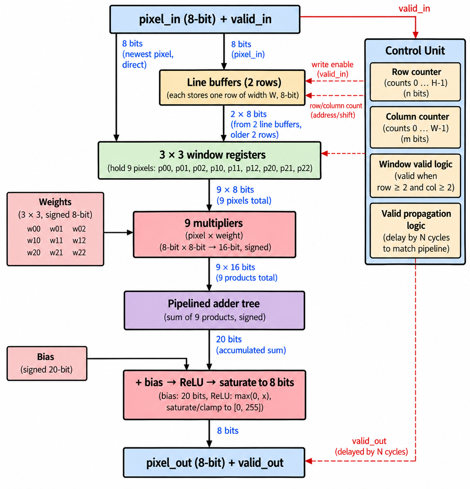
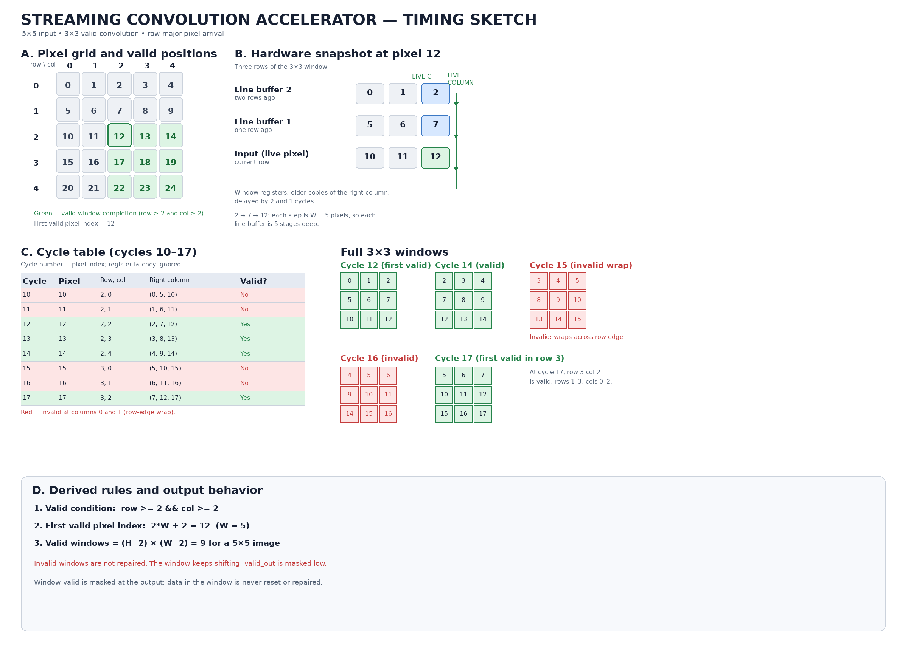

# Streaming Convolution Accelerator

A **SystemVerilog-based streaming image convolution accelerator** designed to process grayscale pixels one per clock cycle using line buffers, a sliding window, and a pipelined arithmetic datapath.

The project focuses on RTL design, hardware pipelining, fixed-point arithmetic, and verification against a Python golden model.

---

## Project Status

**Phase 2 of 6 — Line Buffer & Sliding Window**

| Phase | Milestone | Status |
|:---:|---|:---:|
| 1 | Project setup, golden model, architecture and timing documentation | Complete |
| 2 | Line buffer and 3×3 sliding-window generator | In progress |
| 3 | MAC datapath, adder tree, bias, ReLU and saturation | Planned |
| 4 | Top-level integration and self-checking testbench | Planned |
| 5 | Synthesis, timing and resource-utilization analysis | Planned |
| 6 | Image demonstration and final documentation | Planned |

---

## Architecture

The accelerator uses a streaming architecture to generate 3×3 image windows without storing the entire image in memory.



**Processing flow**

```text
Pixel Stream
     │
     ▼
Line Buffers
     │
     ▼
3×3 Sliding Window
     │
     ▼
9 Parallel Multipliers
     │
     ▼
Pipelined Adder Tree
     │
     ▼
Bias → ReLU → Saturation
     │
     ▼
Output Stream
```

A control unit tracks pixel coordinates and generates `valid_out`, aligned with the datapath latency.

---

## Design Specifications

| Parameter | Specification |
|---|---|
| Input | 8-bit unsigned grayscale pixels |
| Kernel | 3×3, with signed 8-bit weights |
| Multipliers | 9 parallel multipliers (planned datapath) |
| Convolution | Valid-only, no padding |
| Input rate | Up to one pixel per clock when `valid_in` is high |
| Reset | Synchronous, active-high |
| Activation | ReLU |
| Output | 8-bit unsigned, saturated |
| Backpressure | Not supported in the current design scope |

### Convolution and Window Validity

For an input image of height \(H\) and width \(W\), the output dimensions are:

\[
(H-2)\times(W-2)
\]

The first valid window completes at zero-based pixel index:

```text
2*W + 2
```

For row-major input, the window is valid when:

```systemverilog
row >= 2 && col >= 2
```

Invalid windows are not reset or repaired. The window continues shifting, while `valid_out` is held low for invalid positions.

### Arithmetic Datapath

Each 3×3 window is multiplied element-wise by the kernel weights. The products are accumulated, bias is added, and the result passes through an arithmetic right shift, ReLU, and saturation to 8 bits.

The target accumulator width is **20 bits**, subject to the final bias range and overflow analysis.

---

## Timing Analysis

The timing sketch illustrates pixel arrival order, valid-window positions, line-buffer contents, and row-boundary behavior.



Key observations:

- Two line buffers retain pixels from the previous two image rows.
- Horizontal window registers retain the previous two columns.
- For a 5×5 image, the first valid window completes at pixel 12.
- The total number of valid output pixels is \((H-2)(W-2)\).

---

## Repository Structure

```text
stream-conv-accel/
├── rtl/       # SystemVerilog design modules
├── tb/        # Testbenches and verification
├── model/     # Python golden model
├── data/      # Test images and expected outputs
├── docs/      # Architecture and timing diagrams
├── scripts/   # Helper scripts
└── README.md  # Project documentation
```

## Python Golden Model

The reference model is available in [`model/golden.py`](model/golden.py).

It implements:

1. Valid 3×3 window extraction.
2. Signed-weight multiplication and accumulation.
3. Bias addition and arithmetic right shift.
4. ReLU activation.
5. Saturation to an unsigned 8-bit output.

Run the model with Python and NumPy installed:

```bash
python model/golden.py
```

The model serves as the functional reference for future RTL-versus-model verification.

---

## Simulation & Verification

RTL simulation is performed using **AMD Xilinx Vivado (xsim)**.

The repository currently includes an initial counter module and testbench used to validate the simulation workflow. The convolution-specific RTL datapath, line buffers, and self-checking testbench are part of the ongoing development.

---

## Synthesis & Performance Evaluation

Planned evaluation metrics for Phase 5 include:

- Maximum operating frequency (Fmax)
- LUT, flip-flop, DSP and BRAM utilization
- Pipeline-depth trade-offs
- Line-buffer versus frame-buffer memory requirements

Results will be added after synthesis and implementation experiments.

---

## Limitations & Future Work

**Current scope**
- Single-channel image processing
- Fixed 3×3 kernel
- No padding
- No backpressure or ready/valid handshake

**Potential extensions**
- BRAM-based line buffers
- Configurable kernel dimensions
- 2×2 max pooling
- Ready/valid flow control
- Automated RTL-versus-golden-model regression testing

---

## Tools & Technologies

`SystemVerilog` · `Vivado` · `Python` · `NumPy` · `Git` · `GitHub`

---

*An ongoing RTL design project exploring streaming image processing, hardware pipelining, and verification.*